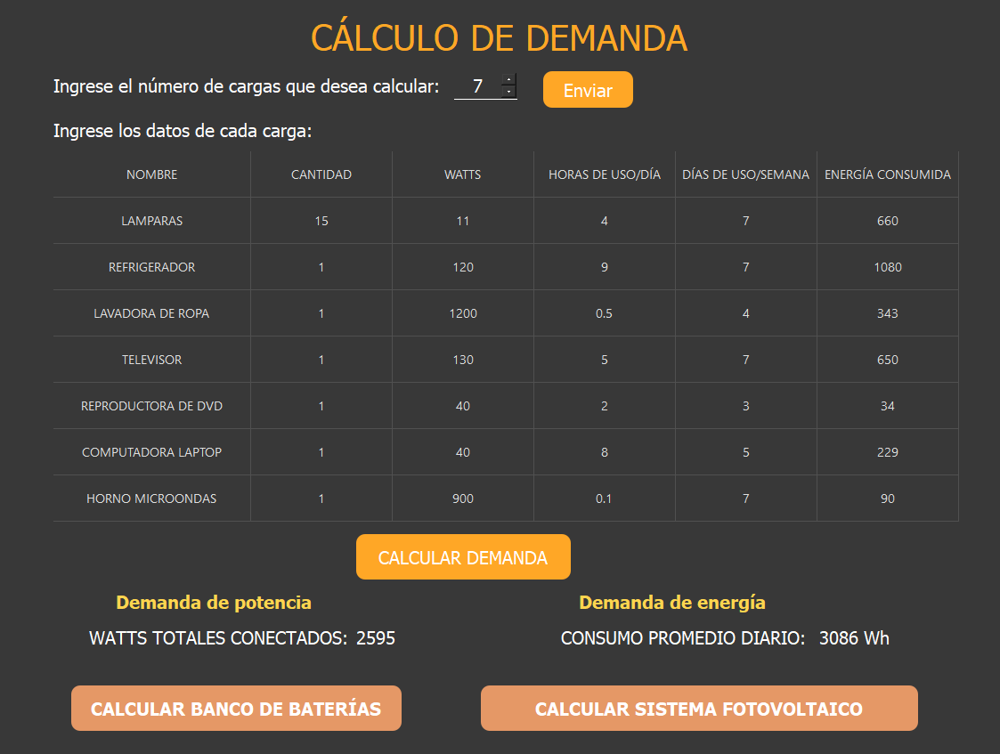
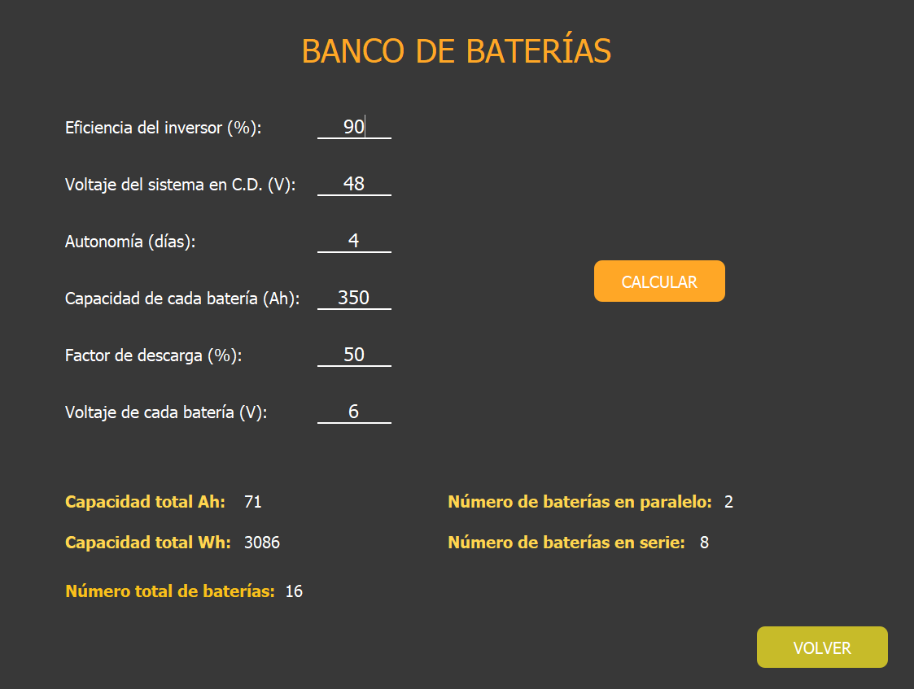
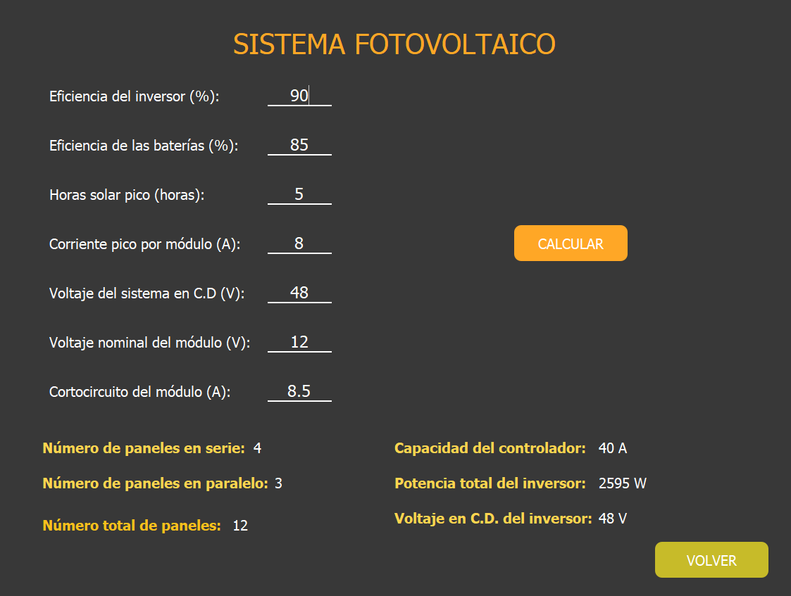

# Sistema Fotovoltaico

Desktop app built with Python and PyQt5 to size an off-grid solar power system from a list of electrical loads.

Aplicación de escritorio para **dimensionar un sistema fotovoltaico aislado**: a partir de las cargas eléctricas calcula la demanda de potencia y energía, el banco de baterías y el número de paneles, el controlador y el inversor.



## Contenido

- [Contexto del proyecto](#contexto-del-proyecto)
- [Características](#características)
- [Capturas](#capturas)
- [Inicio rápido](#inicio-rápido)
- [Uso](#uso)
- [Fórmulas](#fórmulas)
- [Validaciones](#validaciones)
- [Manuales](#manuales)
- [Limitaciones conocidas](#limitaciones-conocidas)
- [Estructura del repositorio](#estructura-del-repositorio)

## Contexto del proyecto

Proyecto académico de la Universidad de los Llanos (Ingeniería Electrónica, electiva profesional *Uso Racional de la Energía*), desarrollado en 2024 por Cristian Gerardo Alvarado Ramírez y Tatiana Vega Cárdenas. Está pensado para estudiantes, ingenieros o cualquier persona interesada en el diseño de sistemas fotovoltaicos.

## Características

- **Cálculo de demanda**: tabla de cargas (nombre, cantidad, watts, horas de uso al día y días de uso a la semana) que devuelve la energía consumida por carga, los watts totales conectados y el consumo promedio diario en Wh.
- **Banco de baterías**: baterías en serie y en paralelo, número total, y capacidad diaria en Ah y Wh.
- **Sistema fotovoltaico**: paneles en serie y en paralelo, total de paneles, capacidad del controlador, potencia del inversor y voltaje en C.D. del inversor.
- Validación de entradas con mensajes de error en español.

## Capturas

| Cálculo de demanda | Banco de baterías |
|---|---|
|  |  |

| Sistema fotovoltaico |
|---|
|  |

Las capturas usan el ejemplo del manual de usuario (7 cargas, 2595 W y 3086 Wh al día).

## Inicio rápido

Requisitos: [Python](https://www.python.org/) 3.8 o superior y PyQt5. Probado con Python 3.13 y PyQt5 5.15.11 en Windows 11. El manual indica compatibilidad con Linux y macOS, que no he probado.

```bash
git clone https://github.com/K18Tatiana/Sistema-Fotovoltaico.git
cd Sistema-Fotovoltaico
pip install pyqt5
python ventana.py
```

La ventana mide 1123×847 px; el manual pide una pantalla de al menos 1280×720.

## Uso

1. **Demanda.** Indica el número de cargas, pulsa **Enviar**, completa la tabla y pulsa **CALCULAR DEMANDA**.
2. **Banco de baterías.** Pulsa **CALCULAR BANCO DE BATERÍAS**, llena los seis parámetros y pulsa **CALCULAR**. **VOLVER** regresa a la primera interfaz.
3. **Sistema fotovoltaico.** Pulsa **CALCULAR SISTEMA FOTOVOLTAICO**, llena los siete parámetros y pulsa **CALCULAR**.

Ambos cálculos parten de la demanda ya calculada: hay que ejecutar el paso 1 primero.

### Ejemplo del manual

| Entrada | Valor |
|---|---|
| Cargas | Lámparas, refrigerador, lavadora, televisor, DVD, laptop y microondas |
| Banco de baterías | Inversor 90 %, sistema 48 V, autonomía 4 días, batería 350 Ah, descarga 50 %, batería 6 V |

Resultado: 2595 W, 3086 Wh/día y 16 baterías (8 en serie × 2 en paralelo).

## Fórmulas

Implementadas en [`ventana.py`](ventana.py):

| Resultado | Cálculo |
|---|---|
| Energía por carga (Wh/día) | `cantidad × watts × horas/día × días/semana ÷ 7` |
| Demanda de potencia | suma de `cantidad × watts` |
| Demanda de energía | suma de la energía por carga |
| Ah/día | `energía ÷ eficiencia del inversor ÷ voltaje del sistema` |
| Baterías en paralelo | `⌈(Ah/día × autonomía) ÷ (capacidad × factor de descarga)⌉` |
| Baterías en serie | `⌈voltaje del sistema ÷ voltaje de la batería⌉` |
| Corriente pico del arreglo | `Ah/día ÷ eficiencia de la batería ÷ horas solar pico` |
| Paneles en paralelo | `⌈corriente pico del arreglo ÷ corriente pico del módulo⌉` |
| Paneles en serie | `⌈voltaje del sistema ÷ voltaje del módulo⌉` |
| Controlador | `1.25 × corriente de cortocircuito × paneles en paralelo`, redondeado al siguiente múltiplo de 10 A |
| Inversor | demanda de potencia (W) y voltaje del sistema |

## Validaciones

| Mensaje | Causa |
|---|---|
| "Por favor, ingrese un número válido." | Valor no numérico, menor o igual a 0, porcentaje mayor a 100, horas/día mayor a 24 o días/semana mayor a 7 |
| "Por favor, complete todas las celdas antes de calcular." | Hay celdas vacías en la tabla de cargas |
| "Por favor, ingrese todos los valores." | Falta algún parámetro en el banco de baterías o el sistema fotovoltaico |

## Manuales

La documentación completa está en el repositorio, en PDF:

- [Manual de Usuario](<Manual de Usuario - Sistema Fotovoltaico.pdf>): requisitos, instalación, descripción de cada interfaz, guía de uso paso a paso y solución de errores.
- [Manual Técnico](<Manual Técnico - Sistema Fotovoltaico.pdf>): arquitectura, componentes, formulación matemática, explicación de las funciones del código, validaciones y diagramas de flujo y de arquitectura.

## Limitaciones conocidas

- No hay pruebas automatizadas ni integración continua.
- El estado entre pantallas (demanda de potencia y de energía) se guarda en variables globales de `ventana.py`.
- Solo aplica las fórmulas anteriores: no considera pérdidas por temperatura, sombreado ni cableado, por lo que los resultados son un dimensionamiento preliminar.
- La columna de resultados de la tabla se titula "Energía consumida" en la interfaz y "watts consumidos" en el manual de usuario.

## Estructura del repositorio

```text
Sistema-Fotovoltaico/
├── ventana.py                    # Lógica de la aplicación y punto de entrada
├── SistemaFotovoltaico.ui        # Diseño de la interfaz (Qt Designer)
├── SistemaFotovoltaico_ui.py     # Interfaz generada a partir del .ui
├── Manual de Usuario - Sistema Fotovoltaico.pdf
├── Manual Técnico - Sistema Fotovoltaico.pdf
└── docs/screenshots/             # Capturas usadas en este README
```
